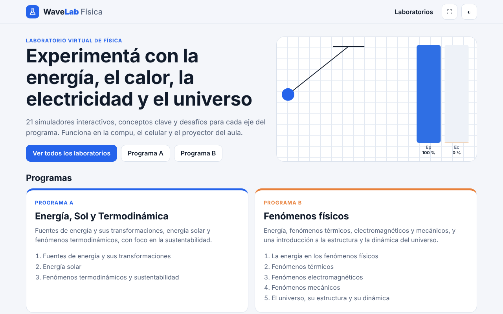

# 🔬 WaveLab Física

> Virtual physics lab for secondary school: 21 interactive simulators, key concepts and randomized challenges organized by curriculum axes.

    



## Overview
A zero-install web lab that lets students experiment with energy, heat, electricity, fluids and the universe from a computer, a phone or the classroom projector. Content follows two official physics programs.

## Key features
- **21 simulators** with live controls, readings and formulas: mechanical energy (skate track), work & power, energy flow diagrams, Kepler's laws, seasons by latitude, solar water heating, greenhouse effect, thermal equilibrium, phase changes, Carnot engines, Coulomb's law, series/parallel circuits with ammeter and voltmeter, electromagnets, hydrostatics, buoyancy, Bernoulli, relativity.
- **Real data**: Argentina and world energy matrices (Argendata, Energy Institute, CAMMESA).
- **Challenges**: 8-question quizzes per axis with randomized numeric problems and explanations.
- **Classroom-ready**: projector mode, light/dark theme, deep links per lab (e.g. `#/lab/circuito/casa`).

## Tech stack
Vanilla JavaScript + HTML5 Canvas, modular simulator files (`js/sims-*.js`), plain CSS. No build step, no backend.

## Run locally
Open `index.html`, or `python3 -m http.server 8080`.

## Project structure
```
js/core.js        canvas, controls and chart utilities
js/sims-*.js      simulators by area
js/programas.js   programs, axes, concepts and prompts
js/quiz.js        question bank
js/app.js         routing and navigation
```

📘 Detailed guide (Spanish): [docs/GUIA.md](docs/GUIA.md)

---

## Author

**Guillermo Cuenya** — Senior QA Automation Engineer / SDET · Telecommunications Engineer  
[LinkedIn](https://www.linkedin.com/in/guillermoadriancuenya/) · [GitHub](https://github.com/gcuenya1)
